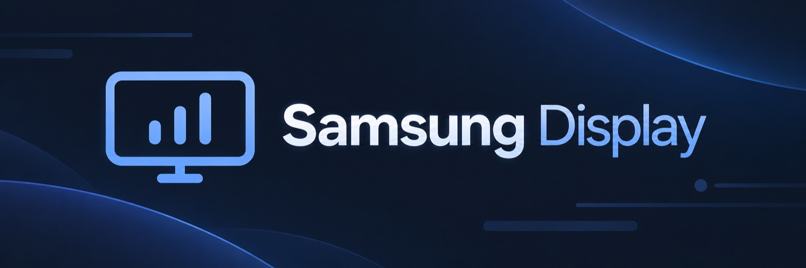
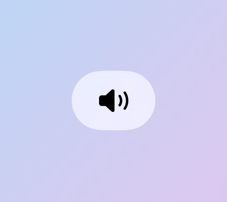
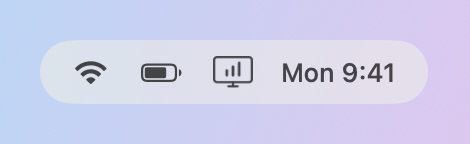
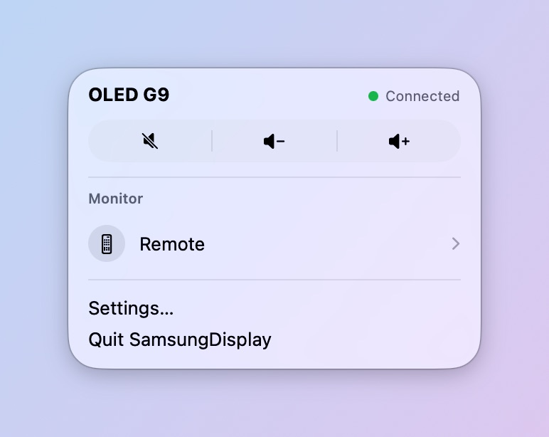
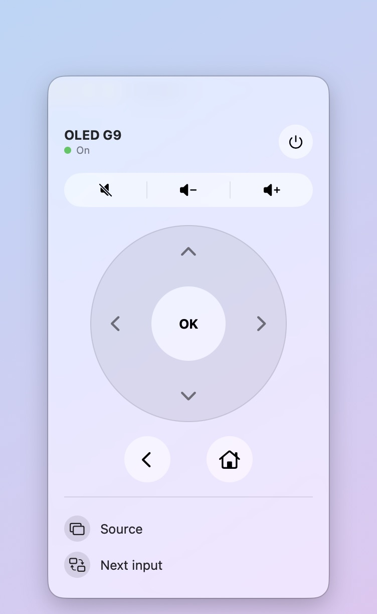
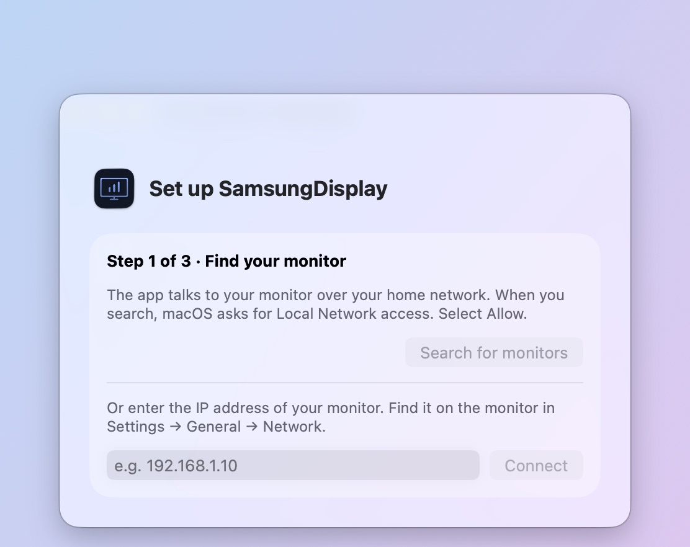
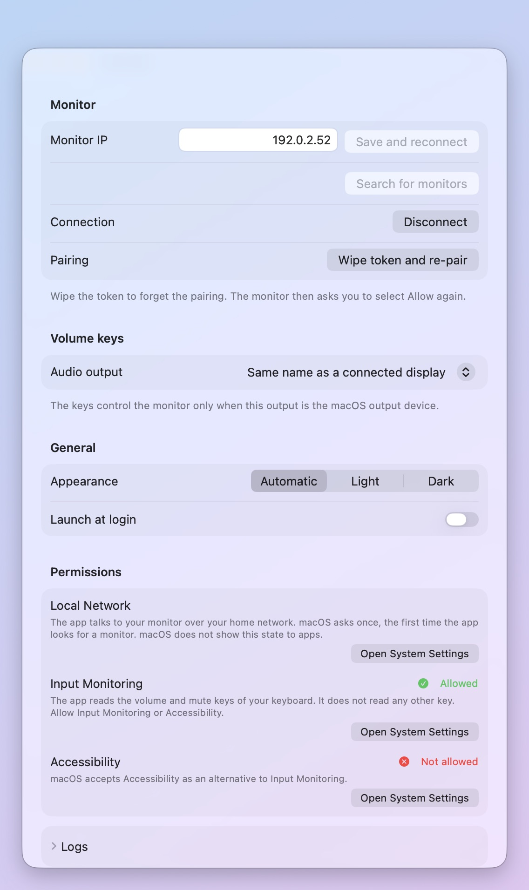

# SamsungDisplay

SamsungDisplay is a free, open-source menu bar app for macOS 26. It controls Samsung smart monitors (Tizen) over your local network. It needs no extra cable and no cloud account. The author tested it on the Odyssey OLED G9 (G95SC).

SamsungDisplay is an independent project. It is not affiliated with or endorsed by Samsung.

## Why use it

Many of these monitors do not support DDC/CI. macOS then cannot change the volume of the monitor speakers.

SamsungDisplay fixes this in two ways:

- The Mac volume and mute keys control the monitor.
- The Remote window replaces the Samsung remote.

## Features

### Volume and mute keys

The Mac volume and mute keys control the monitor, with an on-screen indicator. This works only when the monitor is the macOS audio output.

<picture>
  <source media="(prefers-color-scheme: dark)" srcset="docs/images/osd-dark.jpg">
  
</picture>

### Menu bar

The menu bar icon shows the connection state. Its bars are full when the app is connected.

<picture>
  <source media="(prefers-color-scheme: dark)" srcset="docs/images/menubar-dark.jpg">
  
</picture>

### Popover

The popover has Mute, Volume down, and Volume up buttons. It opens the Remote window and Settings.

<picture>
  <source media="(prefers-color-scheme: dark)" srcset="docs/images/popover-dark.jpg">
  
</picture>

### Remote window

The Remote window has power on and off, Source, Next input, arrows, OK, Back, and Home. The Mac arrow, Return, Escape, and Delete keys also drive it while it has focus.

<picture>
  <source media="(prefers-color-scheme: dark)" srcset="docs/images/remote-dark.jpg">
  
</picture>

### Setup

The app finds monitors on your network. You can also enter the IP address by hand. You pair with the monitor one time. Select Allow on the monitor.

<picture>
  <source media="(prefers-color-scheme: dark)" srcset="docs/images/onboarding-dark.jpg">
  
</picture>

### Settings

- Disconnect stops the connection until you connect again.
- Appearance is Automatic, Light, or Dark.
- The app can launch at login.

<picture>
  <source media="(prefers-color-scheme: dark)" srcset="docs/images/settings-dark.jpg">
  
</picture>

## Requirements

- macOS 26.
- A Samsung smart monitor on the same network as your Mac.
- Local Network permission. The app uses it to find and talk to the monitor.
- Input Monitoring permission (or Accessibility). The app uses it to read the volume and mute keys. It reads no other key.

## Install

1. Download the DMG from [Releases](https://github.com/ferpart/SamsungDisplay/releases).
2. Drag SamsungDisplay to Applications.

## Build

1. Run `xcodegen generate`.
2. Open `SamsungDisplay.xcodeproj` and run the `SamsungDisplay` scheme.

## Signing

The build is ad-hoc signed by default. Each build then gets a new signature. macOS asks again for the Keychain password and resets the key permission.

To keep one signature across builds:

1. Copy `Signing.local.xcconfig.example` to `Signing.local.xcconfig`.
2. Remove the `//` marks from both lines.
3. Set `DEVELOPMENT_TEAM` to your Apple Developer team ID.
4. Set `CODE_SIGN_IDENTITY` to your certificate name, for example `Apple Development`.
5. Run `xcodegen generate` and build again.

Git ignores `Signing.local.xcconfig`. Without the file, the build stays ad-hoc.

## License

MIT. See [LICENSE](LICENSE).
